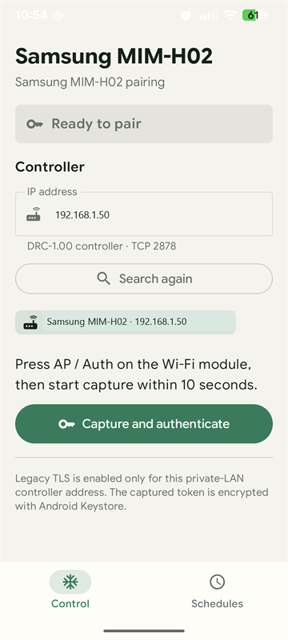
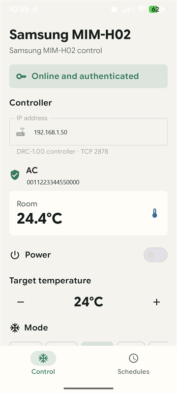
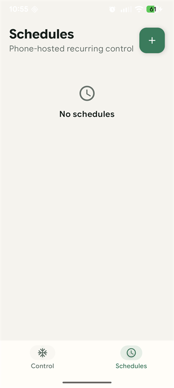

# Samsung MIM-H02

Android app for Samsung MIM-H02 air conditioner Wi-Fi modules.

## Screenshots

   
   
   

## Initial Pairing

1. Connect the phone to the same Wi-Fi network as the MIM-H02.
2. Open the app.
3. Select the discovered controller. If discovery is unavailable, enter its IP
   address manually.
4. Press **AP/Auth** on the Wi-Fi module.
5. Within about 10 seconds, tap **Capture and authenticate**.
6. The app captures the token, reconnects, authenticates it, discovers the first
   indoor unit, and stores the token encrypted on the phone.
